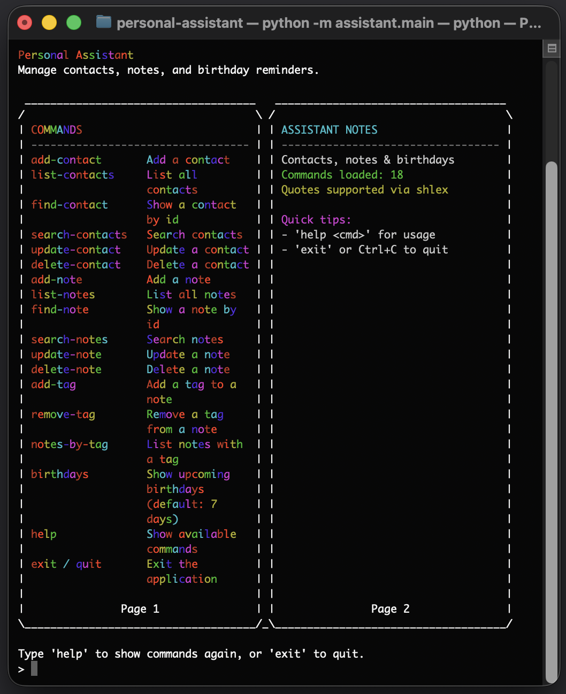

# Personal Assistant

Command-line address book and notes. Contacts, notes, and tags are stored as
JSON in the user's home directory and stay there after the program exits.



## Run

Requires Python 3.12 or newer. Run these commands from the project folder.

### macOS and Linux

```bash
cd personal-assistant
python3.12 -m venv .venv
source .venv/bin/activate
python -m pip install -e ".[dev]"
python -m assistant
```

### Windows

```cmd
cd personal-assistant
py -3.12 -m venv .venv
.venv\Scripts\activate
py -3.12 -m pip install -e ".[dev]"
py -3.12 -m assistant
```

The command list appears, then a `>` prompt. Type a command and press Enter.
`help` lists commands again. `help add-contact` prints one command's usage.
`exit` or `quit` closes the program. A bad command or a bad value prints an
error and the program keeps running.

## Contacts

```text
add-contact "Ada Lovelace" "+44 20 7946 0991" ada@example.com "London" 1815-12-10
list-contacts
find-contact <id>
search-contacts ada
update-contact <id> email ada@example.com
update-contact <id> address clear
delete-contact <id>
birthdays
birthdays 14
```

`add-contact` takes the name, then an optional phone, email, address, and
birthday (`YYYY-MM-DD`). Quote values that contain spaces. A phone must be a
leading `+` and 8 to 15 digits. Spaces and hyphens are allowed.
`ada@example.com` is a valid email. An invalid phone or email is rejected and
is not saved.

`search-contacts` matches part of the name, address, phone, or email, ignoring
case. A digit-only query also matches the digits of a phone number.
`birthdays` without a number uses the next 7 days, including today.

## Notes and tags

```text
add-note "Lecture" "Bring the notebook"
list-notes
find-note <id>
search-notes notebook
update-note <id> content "Bring the notebook and the slides"
delete-note <id>
add-tag <id> school
add-tag <id> python
remove-tag <id> school
notes-by-tag school
```

A note can have several tags. The same tag is not stored twice, and `School`
matches `school`. `notes-by-tag` returns the matching notes sorted by their
tags and then by title. `search-notes` also looks inside tags.

## Data

Files are `contacts.json` and `notes.json` in `~/.personal-assistant`.
Set `PERSONAL_ASSISTANT_DATA_DIR` to store them somewhere else. A failed save
does not replace the previous file.

## Checks

```bash
pytest
ruff check .
ruff format --check .
```

Team workflow and issue boundaries are described in
[CONTRIBUTING.md](CONTRIBUTING.md) and [docs/](docs/).
